# RAGLab

**An evaluation-driven research paper assistant built with Streamlit, local embeddings, FAISS, and Gemini.**

Upload technical PDFs, ask questions across a collection, and inspect the exact passages used to answer. RAGLab keeps PDF extraction, chunking, embeddings, and vector search local to the app process. Gemini receives the question and retrieved evidence to write an answer. A separate command-line benchmark measures retrieval quality without requiring a Gemini call.

> RAGLab is a portfolio MVP and research tool. It is designed to make evidence and retrieval behavior inspectable; it does not guarantee that every generated claim is correct.

## Contents

- [Highlights](#highlights)
- [How it works](#how-it-works)
- [Repository layout](#repository-layout)
- [Requirements](#requirements)
- [Install and configure](#install-and-configure)
- [Use the app](#use-the-app)
- [Run an evaluation](#run-an-evaluation)
- [Run tests](#run-tests)
- [Deploy to Streamlit Community Cloud](#deploy-to-streamlit-community-cloud)
- [Privacy and data handling](#privacy-and-data-handling)
- [Limitations](#limitations)
- [Benchmark provenance](#benchmark-provenance)
- [Screenshots](#screenshots)

## Highlights

- Upload one or more text-based PDFs with file type, file size, and page count safeguards.
- Keep source filename and one-based PDF page metadata on every extracted passage.
- Configure character-based chunk size and overlap, then embed on CPU with `sentence-transformers/all-MiniLM-L6-v2`.
- Retrieve passages with a per-collection FAISS index using cosine similarity.
- Generate answers with the Google Gen AI SDK and a configurable Gemini model. The prompt treats document text as untrusted evidence and asks the model to abstain when the evidence is insufficient.
- Check citations against passages actually returned by retrieval, and inspect those passages in the UI.
- Run reproducible retrieval experiments from the CLI, with dev and held-out splits and JSON result files.
- Run tests and CI without making paid or live Gemini calls.

## How it works

### Question-answering pipeline

```mermaid
flowchart LR
    PDF[PDF uploads] --> Guard[Type, size, and page safeguards]
    Guard --> Extract[PyMuPDF text extraction]
    Extract --> Pages[Page records: filename and one-based page]
    Pages --> Chunk[Overlapping character chunks]
    Chunk --> Embed[MiniLM embeddings on CPU]
    Embed --> Index[Normalized vectors in a collection-scoped FAISS index]

    Q[User question] --> QEmbed[Embed the question]
    QEmbed --> Search[Cosine top-K search]
    Index --> Search
    Search --> Prompt[Question plus retrieved evidence]
    Prompt --> Gemini[Configurable Gemini model]
    Gemini --> Check[Parse answer and validate citations]
    Check --> UI[Answer, page citations, and expandable passages]
```



1. **Validate and extract.** RAGLab accepts PDFs, checks the configured size and page limits, and extracts selectable text with PyMuPDF. Empty or scanned PDFs without extractable text receive a clear error. Each nonempty page is recorded with its original filename and one-based page number.
2. **Chunk and embed.** Each page is split into overlapping character chunks. Chunk boundaries stay within a page so citations keep the source page. MiniLM creates normalized vectors locally on CPU.
3. **Index and retrieve.** Every collection gets its own in-memory FAISS `IndexFlatIP` index. RAGLab embeds a question and returns the highest-scoring passages by cosine similarity. Collections are isolated from one another.
4. **Generate and check.** The app sends the question and retrieved passages to the configured Gemini model. The prompt says that PDF content is untrusted data, must not override the instructions, and cannot support an answer unless the evidence does. The response is requested as structured JSON. Citation source, page, and chunk ID must match a retrieved passage.
5. **Show the evidence.** The UI displays the answer and its source/page citations. An expandable panel shows the retrieved text and similarity score so a reader can check the evidence directly.

### Evaluation pipeline

The evaluation runner is independent of Streamlit. It loads a versioned JSONL dataset and its curated text corpus, chunks and embeds the corpus, builds a FAISS index, and scores retrieval for each question. It can optionally call Gemini to measure answer, citation, and abstention behavior. Retrieval-only mode is the default and does not consume Gemini quota.

The runner keeps the `dev` split for configuration comparisons and the `heldout` split for a final check after selecting settings. Each run records its dataset version, split, configuration, embedding model, timestamps, metrics, and timing in a JSON file under `data/evaluation/results/`. Result files are ignored by Git so generated measurements do not become repository data by accident.

## Repository layout

| Path                              | Purpose                                                                                         |
| --------------------------------- | ----------------------------------------------------------------------------------------------- |
| `app.py`                          | Streamlit interface, collection management, chat, evidence display, and evaluation results view |
| `src/config.py`                   | Environment and Streamlit secrets configuration                                                 |
| `src/documents.py`                | PDF validation, text extraction, page metadata, and chunking                                    |
| `src/retrieval.py`                | Cached CPU embedding model, FAISS index, and dense retrieval                                    |
| `src/generation.py`               | Grounded Gemini generation and citation validation                                              |
| `src/evaluation/metrics.py`       | Deterministic metric functions and reference-answer rubric                                      |
| `src/evaluation/runner.py`        | Command-line benchmark runner and JSON result writer                                            |
| `data/evaluation/benchmark.jsonl` | Version-controlled questions, answers, evidence IDs, answerability labels, and source URLs      |
| `data/evaluation/schema.json`     | JSON Schema for benchmark records                                                               |
| `data/evaluation/corpus/`         | Curated source-derived text passages used by the starter benchmark                              |
| `tests/`                          | Unit tests, including mocked Gemini generation behavior                                         |
| `.github/workflows/tests.yml`     | GitHub Actions workflow for installing dependencies and running pytest                          |
| `docs/ARCHITECTURE.md`            | Short architecture reference                                                                    |
| `docs/EVALUATION.md`              | Metrics, rubric, benchmark provenance, and evaluation protocol                                  |
| `docs/EXPERIMENT_LOG_TEMPLATE.md` | Template for recording future experiments                                                       |
| `docs/DEVELOPMENT_LOG.md`         | Implementation decisions, completed checks, and next steps                                      |

## Requirements

- Python 3.12 is the recommended and verified development version.
- A Gemini API key is needed to answer questions. Retrieval and the normal test suite do not need a Gemini API call.
- The first use downloads the MiniLM model weights from Hugging Face. Allow several hundred MB of local model/cache space and network access for that initial download.
- The pinned PyTorch wheel in `requirements.txt` is the CPU build from the official PyTorch CPU package index and targets Linux. Windows and macOS users may need to install a platform-specific CPU PyTorch build and adjust that pin.

## Install and configure

Run these commands from the repository root:

```bash
python3 -m venv .venv
source .venv/bin/activate
python -m pip install -r requirements.txt
cp .env.example .env
```

Open `.env` in a local editor and set your key:

```dotenv
GEMINI_API_KEY=your_key_here
```

Do not paste the key into source files or commit `.env`. It is excluded by `.gitignore`. The committed `.env.example` contains only a blank `GEMINI_API_KEY=` entry.

Optional settings can be exported as environment variables or placed in `.env`:

| Variable          | Default                                  | Purpose                                    |
| ----------------- | ---------------------------------------- | ------------------------------------------ |
| `GEMINI_MODEL`    | `gemini-3.5-flash-lite`                  | Gemini model ID used for answer generation |
| `EMBEDDING_MODEL` | `sentence-transformers/all-MiniLM-L6-v2` | Sentence Transformers model ID             |
| `MAX_UPLOAD_MB`   | `25`                                     | Maximum size for each PDF                  |
| `MAX_PDF_PAGES`   | `500`                                    | Maximum pages in each PDF                  |
| `CHUNK_SIZE`      | `900`                                    | Default chunk size in characters           |
| `CHUNK_OVERLAP`   | `150`                                    | Default overlap in characters              |

Check Google’s [current Gemini model list](https://ai.google.dev/gemini-api/docs/models) before changing `GEMINI_MODEL`. RAGLab uses the `google-genai` SDK.

## Use the app

Start Streamlit from the repository root:

```bash
streamlit run app.py
```

1. Enter a collection name in the sidebar.
2. Upload one or more research PDFs and choose **Build collection**. Extraction and embedding happen locally; the first build may take longer while the model loads.
3. Ask questions in **Ask papers**. Each answer includes source and page citations, and the evidence panel shows retrieved passages and scores.
4. Use the collection selector to switch between independent collections. Remove the active collection when you no longer need it.
5. Set top-K, chunk size, and overlap in the sidebar. Chunking settings take effect when a collection is built, so rebuild after changing them.
6. Open **Evaluation** to view JSON results generated by the benchmark CLI. The **How it works** tab summarizes the pipeline and temporary storage behavior.

The built-in upload limit is 25 MB per file and 500 pages per file by default. Text extraction only is supported; run OCR on scanned PDFs before uploading them.

## Run an evaluation

### Compare settings on the dev split

```bash
python -m src.evaluation.runner --split dev --compare
```

`--compare` runs a baseline and varies one setting at a time:

| Configuration           |   Chunk size |     Overlap |   Top-K |
| ----------------------- | -----------: | ----------: | ------: |
| Baseline                |          900 |         150 |       5 |
| Chunk size alternatives | 700 and 1200 |         150 |       5 |
| Overlap alternatives    |          900 | 100 and 250 |       5 |
| Top-K alternatives      |          900 |         150 | 3 and 8 |

Run only one parameter family with `--sweep`:

```bash
python -m src.evaluation.runner --split dev --sweep top_k
python -m src.evaluation.runner --split dev --sweep chunk_size
python -m src.evaluation.runner --split dev --sweep chunk_overlap
```

To check a selected configuration against the held-out examples, run it after tuning on `dev`:

```bash
python -m src.evaluation.runner \
  --split heldout \
  --chunk-size 900 \
  --chunk-overlap 150 \
  --top-k 3
```

### Metrics

- **Recall@K:** fraction of labeled relevant evidence retrieved within the first K results.
- **MRR:** reciprocal rank of the first relevant result, averaged across answerable questions.
- **Precision@K:** fraction of the first K results that match labeled relevant evidence.
- **Retrieval latency:** query embedding plus FAISS search time; reports mean and p95.
- **End-to-end latency:** question retrieval plus Gemini generation time when generation evaluation is enabled.
- **Citation validity:** fraction of returned citations that exactly match retrieved source, page, and chunk IDs.
- **Reference-answer lexical coverage:** overlap with the reference answer using a documented token-coverage rubric. It is a simple automatic proxy, not an LLM judge or ground truth.
- **Abstention accuracy:** whether the answer abstains for unanswerable questions and answers answerable ones.

Retrieval metrics are averaged over answerable questions. The unanswerable examples are used for abstention scoring, not retrieval recall. Generation-specific fields are `null` and marked `not_run` by default.

To include Gemini generation, citation, answer-coverage, and abstention metrics, add `--generate`:

```bash
python -m src.evaluation.runner --split dev --generate
```

This makes live Gemini calls and may consume API quota. The test suite mocks generation and does not require these calls.

See [docs/EVALUATION.md](docs/EVALUATION.md) for the dataset schema, interpretation guidance, and provenance. The starter set is intentionally small; measured values are useful for checking the pipeline, not for broad quality claims.

## Run tests

```bash
python -m pytest -q
```

The tests cover PDF extraction and page metadata, chunking, FAISS ranking and empty indexes, hand-computed metrics, citation checks, abstention, secret configuration, and mocked Gemini responses. GitHub Actions runs the same suite on pushes and pull requests.

## Deploy to Streamlit Community Cloud

1. Push this repository to GitHub.
2. In Streamlit Community Cloud, create an app from the repository, select the branch, and set the entrypoint to `app.py`.
3. In deployment **Advanced settings**, select Python 3.12 and add the secret below in the **Secrets** field:

   ```toml
   GEMINI_API_KEY = "your_key_here"
   GEMINI_MODEL = "gemini-3.5-flash-lite"
   ```

4. Deploy the app. For an existing deployment, update secrets through its app settings.

Community Cloud installs Python packages from the root `requirements.txt`. RAGLab reads `GEMINI_API_KEY` from Streamlit secrets on the hosted app and from `.env` or the environment locally. See Streamlit’s current [deployment guide](https://docs.streamlit.io/deploy/streamlit-community-cloud/deploy-your-app/deploy), [dependency guide](https://docs.streamlit.io/deploy/streamlit-community-cloud/deploy-your-app/app-dependencies), and [secrets guide](https://docs.streamlit.io/deploy/streamlit-community-cloud/deploy-your-app/secrets-management).

Uploads, conversation state, and FAISS indexes are temporary in-memory data. A session ending or app restart clears them. The app does not use a paid database or hosted vector store. Community Cloud availability and free Gemini quota are not guaranteed.

## Privacy and data handling

- Uploaded PDFs are parsed and embedded in the app process; RAGLab does not persist uploads or indexes to disk.
- On each question, the user’s question and retrieved text passages are sent to Gemini for answer generation. Do not upload documents unless you are authorized to send their retrieved content to the configured Gemini API.
- Document text is passed as evidence and explicitly marked as untrusted in the generation prompt. This reduces prompt-injection risk but cannot guarantee model behavior.
- `.env`, virtual environments, local caches, uploads, indexes, and generated evaluation result files are ignored by Git.

## Limitations

- Scanned PDFs require external OCR. OCR is not included.
- Extraction is text-based; tables, figures, equations, and complex multi-column layouts may not be represented reliably.
- Retrieval uses dense similarity only. There is no BM25, hybrid retrieval, reranker, or query expansion.
- The in-memory index and chat state are session scoped and disappear on restart.
- A citation check verifies that a citation points to a retrieved passage. It cannot prove that the passage supports every sentence in the answer.
- The benchmark is small and its curated evidence corpus is based on article sections rather than the source PDF. It does not evaluate true page-level citations. Use your own PDFs to inspect actual page citations.
- The lexical reference-answer score can miss valid paraphrases and reward word overlap without semantic correctness. Human review remains necessary.

## Benchmark provenance

The starter benchmark is manually checked and derived from Iyer et al. (2025), “Careful design of Large Language Model pipelines enables expert-level retrieval of evidence-based information from syntheses and databases,” _PLOS ONE_ 20(5), e0323563, [doi:10.1371/journal.pone.0323563](https://doi.org/10.1371/journal.pone.0323563). PLOS identifies the article as open access under its Creative Commons Attribution License. The repository contains short paraphrased evidence passages, question text, and answer references rather than the full paper. Retain the attribution when reusing this source-derived benchmark material. See [docs/EVALUATION.md](docs/EVALUATION.md) for details.

## Screenshots

No screenshots are included yet.
